## Buildings

### Biodome

The Biodome is the heart of a colony, establishing its central hub and initial zone of control. Its tile is always worked, providing all the living quarters for a growing population. The building boosts the colony’s baseline growth rate and grants starting storage for Food, Material, Energy, Wealth, and Happiness. Functioning as a self‑contained city, the Biodome includes limited solar power generation, hydroponic food production, fresh‑water extraction (via wells or nearby rivers), and basic manufacturing. It also holds modest reserves of energy (batteries), food, water, and warehouse space. Drones attached to the Biodome can explore beyond its borders and can monitor neighboring colonies.

### Habitat

The Habitat is dedicated housing — the fastest way to grow a colony past the point where its lone Biodome runs out of room. Where every other structure merely tends the land, the Habitat builds *up*, stacking living quarters, life‑support, and community space into a dense arcology that both quickens population growth and lifts the ceiling on how many colonists a colony can hold. It may be raised on most habitable land and needs no other building first. It is a substantial, costly undertaking to build and a hungry one to run, drawing on nearly every resource to keep its systems and residents going. In return a worked Habitat speeds the colony's population growth, lifts morale, returns a healthy flow of wealth, and — crucially — greatly raises the colony's population ceiling, with a little general storage besides. Work several Habitats and a colony can swell far beyond what the land alone would support.

A Habitat **must always be worked** to count. That one worker runs the support services — the shops, stores, clinics, and civic amenities — that a growing population needs; without them the arcology is just empty shells and adds no room at all. So a Habitat only raises the colony's population ceiling while it is staffed, and a managed colony will always keep a worker assigned to it, freeing up a worker from a lower‑priority cell if every slot is already full.

### Solar Panels

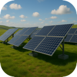

Solar Panels are advanced energy collectors — a cheap, quick build with almost no upkeep. Each panel is a steady source of energy and adds a good deal of energy storage to the colony, but it provides no food, material, or wealth of its own. Most of a colony's advanced buildings depend on a Solar Panel being present first, making it the usual second structure a colony raises.

### Solar Farm

The Solar Farm is the Solar Panel's big sibling — a sprawling array that drinks in far more of the twin stars' light. It is built as an **upgrade of an existing Solar Panel**, raised in its place, and still counts as a Solar Panel for anything that depends on one. A larger, costlier structure than a single panel, it is a powerful source of energy and greatly expands the colony's energy storage. When a colony's industry outgrows what its panels can supply, upgrading a key panel to a Solar Farm keeps the lights on.

### Nuclear Reactor

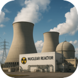

The Nuclear Reactor is the pinnacle of power generation — a hardened fission plant that dwarfs any field of solar panels, pouring out a torrent of energy day or night, in any climate (it may even be raised on the frozen poles). It is a demanding, late‑game build: it requires a **Factory** in the colony, a sizable population, a heavy investment of energy, material, and wealth to construct, and — crucially — a worked source of the strategic resource **uranium** to fuel it. In return a worked Reactor is by far the largest single energy source in the game and adds a vast reserve of energy storage, enough to run the most power‑hungry industry, defenses, and launch facilities a colony can field. For an advanced, uranium‑rich colony, it is what finally lifts the ceiling on everything energy can buy.

### Farm
 

The Farm is the mainstay food‑production facility for your colony. It can be built only after a Solar Panel is present. Cheap and quick to raise with light upkeep, each Farm is a dependable source of food, adds a little wealth and a small nudge to growth, and expands the colony's food storage. Farms are what let a colony feed a rising population and keep expanding.

### Agridome

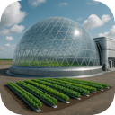

The Agridome is the Farm's industrial successor — a sealed, climate‑controlled growing complex that squeezes far more food from the same ground. It is built as an **upgrade of an existing Farm**, raised in its place, and still counts as a Farm for anything that depends on one. It requires a **Biodome** and a **Solar Farm** in the colony and a colony population of at least 5,000. Its yield *scales with the richness of its cell*, multiplying that tile's food several times over, and it brings a healthy stream of wealth besides. A major build with a heavy, broad upkeep — power, goods, material, wealth, and a large thirst for water — it is how a maturing colony turns a productive farm tile into a breadbasket.

### Aquafarm

The Aquafarm is the sea's answer to the Farm — a floating lattice of pens, kelp racks, and shellfish beds that harvests food from the water instead of the land. It is built on the shallows within a colony's reach and requires a **Dock** first (the Dock opens the colony's sea tiles to work and gives the Aquafarm its harbor). Its catch *scales with how rich the water beneath it is*, so the most productive, bonus‑rich shallows make the best sites. Quick and inexpensive to raise with modest upkeep, it also brings in a steady flow of wealth. For coastal and island colonies — where arable land is scarce but shallow sea is plentiful — the Aquafarm is the mainstay of the food supply.

### Mine

The Mine is the colony's dedicated material producer, carving ore and stone straight out of the ground. Its output *scales with how mineral‑rich the ground beneath it is*, so a Mine on rugged, ore‑laden terrain hauls up a tremendous amount — plant them on the richest ground you can reach. It requires a **Solar Panel** first and, uniquely, may be worked on the high, cold, and broken terrain other buildings avoid, where ore is richest — though the most forbidding mountain summits remain off‑limits to everyone. It is a modestly priced build with a steady energy appetite to run its machinery, and it adds a good deal of material storage. A single well‑sited Mine can single‑handedly feed a colony's Factories and keep its road network supplied with material.

### Megamine

The Megamine is the Mine scaled up to heavy extraction — a vast open‑pit and deep‑shaft complex that tears material from the ground on a scale no single Mine can match. It is built as an **upgrade of an existing Mine**, raised in its place, and still counts as a Mine for anything that depends on one. It requires a **Solar Farm** in the colony. Like the Mine, its yield *scales with how mineral‑rich the cell beneath it is* — on the richest ground it multiplies that tile's material enormously — and it brings a healthy stream of wealth besides, with large material storage to match. It is a costly build with a voracious appetite for energy and goods to keep its machinery and crews running, and the scarred land weighs a little on morale. When a colony's Factories outgrow what its Mines can supply, upgrading a key Mine to a Megamine is how its material output takes off.

### Factory

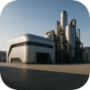

The Factory turns raw material into manufactured goods. It requires a Solar Panel before it can be constructed. It is a serious build with a heavy, ongoing appetite for material and energy, and its smokestacks weigh a little on both growth and morale — but it is the backbone of an industrial economy, producing goods and wealth and expanding the colony's material and energy storage. Many advanced structures depend on a Factory being present first.

### Megafactory

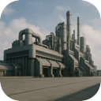

The Megafactory is the Factory scaled up to heavy industry — a vast production complex that pours out manufactured goods on a scale no single Factory can match. It is built as an **upgrade of an existing Factory**, raised in its place, and still counts as a Factory for anything that depends on one. It requires a **Solar Farm** in the colony and a colony population of at least 10,000. It produces a large flow of goods and a good deal of wealth and holds enormous reserves of goods and material — but it is a costly build with a voracious, ongoing appetite for energy and material, and the smoke and sprawl weigh a little on morale. For an industrial powerhouse, upgrading a key Factory to a Megafactory is how a colony's output takes off.

### Nanofactory

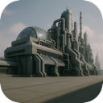

The Nanofactory is the pinnacle of manufacturing — molecular‑assembly works that fabricate goods with near‑perfect efficiency. It is built as an **upgrade of an existing Megafactory**, raised in its place, and still counts as a Factory (and Megafactory) for anything that depends on one. It requires a **Solar Farm** and a **Bank** in the colony and a colony population of at least 15,000. It is the single greatest source of goods and wealth a colony can field, with colossal goods, material, and energy storage to match — but it is an extraordinarily expensive, late‑game build with the heaviest upkeep of any structure, demanding immense energy and material to keep its assemblers running, and its scale weighs a little on morale. It is the crowning achievement of an industrial economy.

### Dock

The Dock creates a coastal transportation network, linking colonies that also have Docks so they can share resources across the sea. A Dock sits on a
  shallow-sea tile, opens the colony's shallow-sea tiles to being worked, and
  lets new colonies be launched across shallow sea (to reach islands and cross straits). It requires a Solar Panel in the colony. It is a cheap build with light upkeep, provides a little food and wealth, and adds useful storage. The Dock is the gateway to seafaring: the coastal buildings and the sea network all begin with it.

### Port

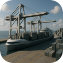

The Port is the Dock's big sibling — a full deep‑water harbor that opens travel across the open ocean, not just the shallow coastal waters a Dock reaches. Where a Dock lets ships cross only the shallows, a Port's owner can route across the open sea, linking far‑flung island and coastal colonies that no Dock could reach. It is built as an **upgrade of an existing Dock**, raised in its place (and it still needs a Solar Panel in the colony). A larger, more costly structure than the Dock, it returns more food and wealth and adds more storage. For a seafaring empire, upgrading a key coastal Dock to a Port is what turns scattered holdings into one connected maritime network.

### Air Field

The Air Field creates an air‑transportation network, linking nearby colonies that also have one so they can share resources across terrain no road could cross. It requires a **Factory** before it can be built. A moderate build with light upkeep, it returns a little wealth and adds useful storage. Its reach is limited to colonies a modest distance apart — for longer links, upgrade it to an Airport.

### Airport

The Airport is the Air Field's big sibling — a full international hub that extends the air network far beyond a modest airstrip, drawing in colonies much farther away than an Air Field could reach. It is built as an **upgrade of an existing Air Field**, raised in its place (and it still counts as an Air Field for anything that requires one, such as the Spaceport). A large, expensive structure that is demanding to run, it returns a good flow of wealth, lifts morale, and adds generous storage. For a sprawling empire, a well‑placed Airport is what stitches far‑flung colonies into one air network.

### Launchpad

The Launchpad is your first foothold in the **space transport network** — a modest pad for orbital shuttles that links any two of your colonies regardless of distance or terrain, the moment it is built. Like the Dock and the Air Field, it provides its link as soon as it is **operational**; its tile need not be worked. It requires an **Air Field**, a **Factory**, and a **Bank** first, a warm tropical or temperate climate, and access to the strategic metals (aluminum, titanium, and crystal) its rockets demand. Cheap and quick to raise for what it offers, it is the practical way to stitch a far‑flung outpost into your civilization long before you can afford its grander successor — and it is built as the foundation that later becomes a **Spaceport**.

### Spaceport

The Spaceport is the **upgrade of a Launchpad**, raised in its place as the full capstone of the **space transport network** — the only link with no limit on distance at all. Any two of your colonies joined to the space network are connected and share resources no matter how far apart they lie or what terrain divides them. Unlike the Launchpad, a Spaceport provides its link **only while its own tile is worked** — a built‑but‑idle Spaceport carries no traffic. It is a late‑game structure that requires an **Air Field**, **Factory**, and **Bank**, a warm tropical or temperate climate, and the strategic metals its heavy lift demands. A major build with a voracious energy appetite to keep its launch systems running, it returns a little wealth and lifts morale — but its true value is tying the most distant colonies directly into the heart of your civilization.

### ICBM Factory

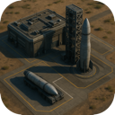

The ICBM Factory is where a colony builds its strategic missile arsenal — the **only** structure that can construct **ICBMs**, the long‑range, single‑use nuclear weapons. It is a top‑tier build gated behind the full space‑age chain: the colony must already have a **Launchpad** (to loft the missiles) and a **Nuclear Reactor** (to supply both the power and the uranium‑fueled infrastructure its warheads demand), a transport link to another of your colonies, and a large population, with a heavy, broad construction cost and upkeep. It holds a modest reserve of energy, goods, and material, and can field up to **five ICBM silos**, each steadily arming a missile over time. Once armed, those ICBMs can be launched at any colony on the planet — and are spent in the strike. For a mature, uranium‑rich civilization, the ICBM Factory is the key that unlocks planet‑spanning nuclear reach.

### Granary

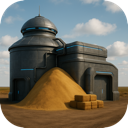
 
The Granary provides large‑scale food storage, greatly increasing how much food a colony can stockpile. It can be built after a **Farm** is built. Cheap to raise, it has no upkeep and produces nothing on its own — it exists purely to let a colony bank a surplus of food against lean years and growth spurts.

### Materials Depot

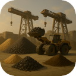

The Materials Depot is bulk storage for raw **Material** — the ore, stone, and timber mined and harvested from the land before it is refined into Goods. It greatly increases a colony's material storage, giving mining‑heavy colonies somewhere to stockpile the raw stock that feeds their Factories. It can be built after a **Factory** is present, is cheap to raise with a small upkeep, and produces nothing on its own — it is the raw‑materials counterpart to the Warehouse, which stores finished Goods.

### Warehouse

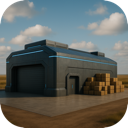

The Warehouse greatly boosts how many manufactured **Goods** a colony can store. It can be built after a **Factory** is built, is cheap to raise, and has no upkeep or production of its own — it serves solely to stockpile finished goods.

### Bank

The Bank speeds up the colony's economy and unlocks more advanced building projects. It requires a **Solar Panel** before it can be built. A modest build, it more than pays for its upkeep by generating a steady flow of wealth, lifts morale a little, and greatly expands the colony's wealth storage.

### Global Bank

The Global Bank is the Bank elevated to a world financial center — a central clearinghouse that moves wealth across the whole Federation. It is built as an **upgrade of an existing Bank**, raised in its place, and still counts as a Bank for anything that depends on one. It requires a **Solar Farm** in the colony and a colony population of at least 15,000. Where a Bank returns a steady trickle of wealth, a Global Bank pours out a torrent of it, lifts morale more strongly, and holds vast wealth reserves — both in the colony and in the Federation treasury. A costlier build with heavier upkeep, upgrading a key Bank to a Global Bank is how a mature economy turns prosperity into real financial power.

### Compressed-Air Energy Storage

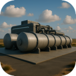

The Compressed‑Air Energy Storage (CAES) is an advanced energy‑storage facility. It requires a **Bank** before it can be built. A modest build with light upkeep, it greatly expands how much energy a colony can bank — letting energy‑hungry industry ride out shortfalls.

### Water Treatment Plant

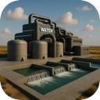

The Water Treatment Plant (WTP) draws from a nearby river or canal and purifies it into clean fresh water for the colony's people, farms, and industry. It must be built on habitable land **beside a river or canal** and requires a **Solar Panel** first. A major build with a heavy energy appetite to run its pumps and filtration, it is a strong, steady source of water and adds water storage besides — the mainstay water supply for any colony settled along the planet's inland waterways.

### Reservoir

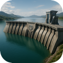

The Reservoir is a vast impounded water store — a dammed basin that banks enormous quantities of fresh water against drought and surging demand. It must be built on habitable land **beside a river or canal** (its catchment) and is a late‑game undertaking: it requires a **Global Bank** in the colony, a transport link to another of your colonies, and a colony population of at least 20,000. It produces nothing on its own and carries a modest upkeep, but it **massively** expands both the colony's and the Federation's water storage — the strategic reserve that lets a sprawling, water‑hungry civilization ride out the leanest years.

### Desalination Plant

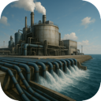

The Desalination Plant turns the limitless sea into drinkable water, built on the shallows within a colony's reach. It requires a **Solar Farm** first. Construction is a major undertaking, reflecting the vast reverse‑osmosis works it entails, and its hallmark is a voracious appetite for power. In return it is a reliable source of water with water storage to match. Where a river‑fed Water Treatment Plant isn't an option, desalination keeps coastal and island colonies alive — provided they can feed its enormous energy demand.

### Outpost

The Outpost is how a colony reaches out and claims a prize just beyond its grasp. Unlike every other structure, it is **not** built inside a colony's zone of control — it is raised **one cell outside** that border, on a tile that holds a **terrain bonus** the colony cannot otherwise reach. A small, self‑sufficient station of automated harvesters and drones, the Outpost taps that deposit and pipes its yield straight back home: the terrain bonus's resource becomes available to the owning colony, and — if that colony is networked to the capital — to the whole Federation as well. Crucially, the Outpost **needs no worker to operate**; it does not draw a worker from the colony the way a worked cell does, so its bonus comes at no cost to the colony's labor. It is the way to secure a rich vein, a rare grove, or an ancient ruin that lies tantalizingly just past the frontier, without founding a whole new colony to do it.
