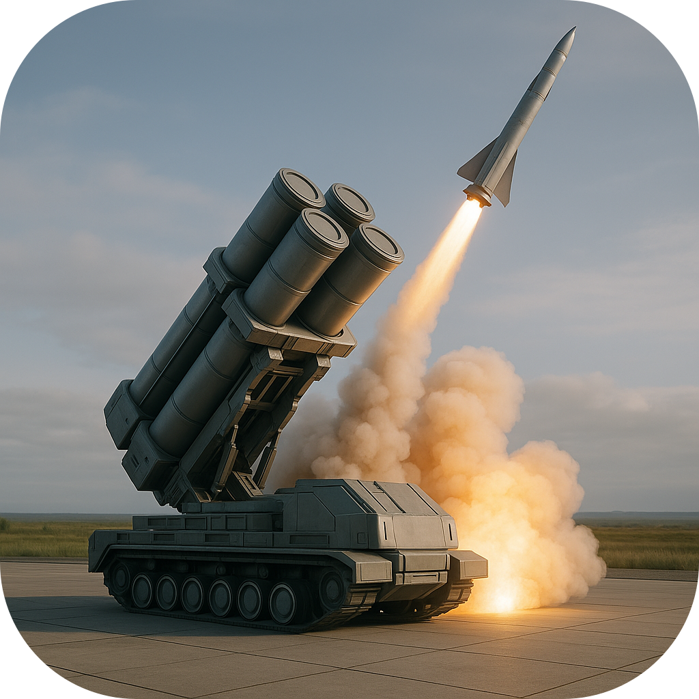
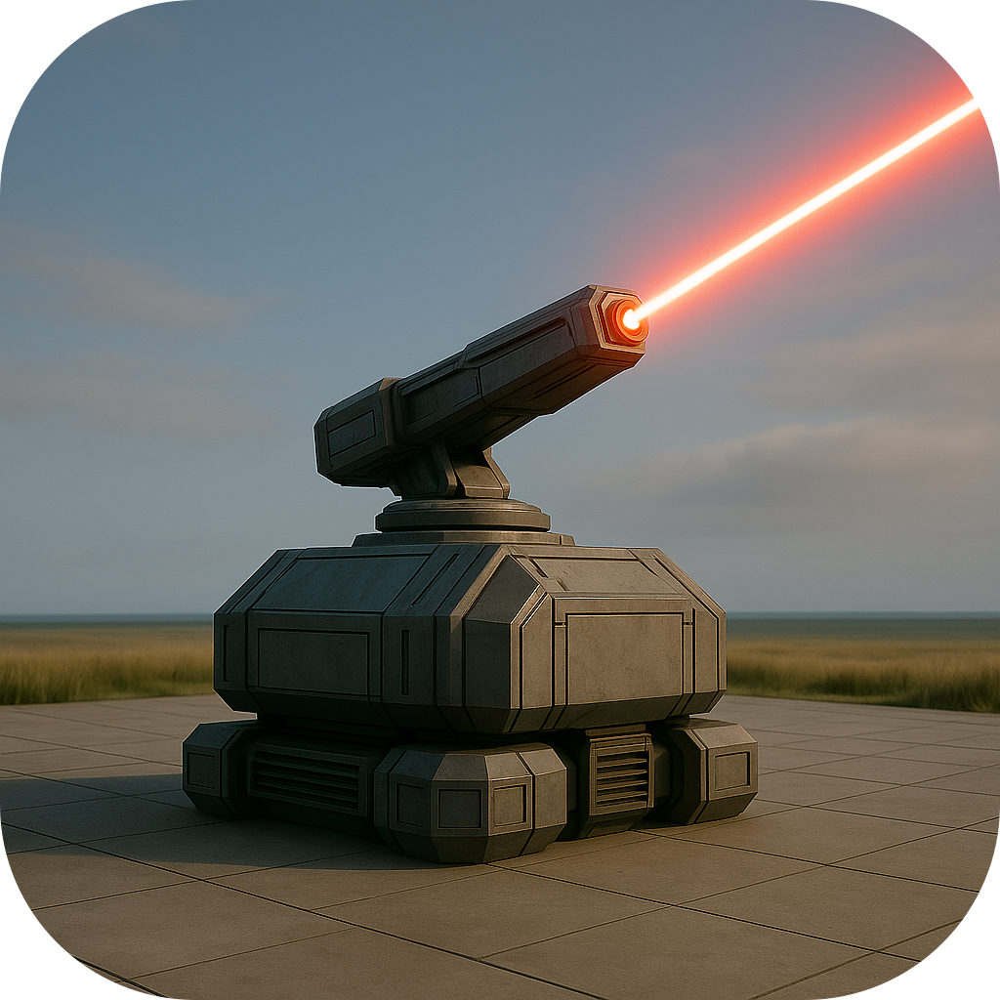
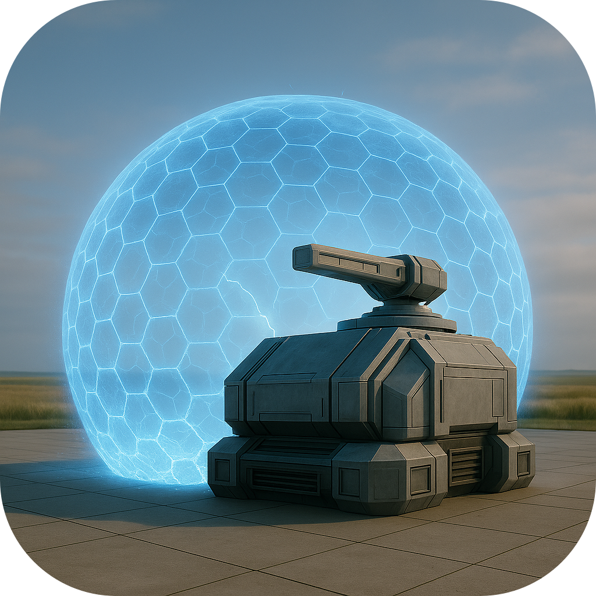
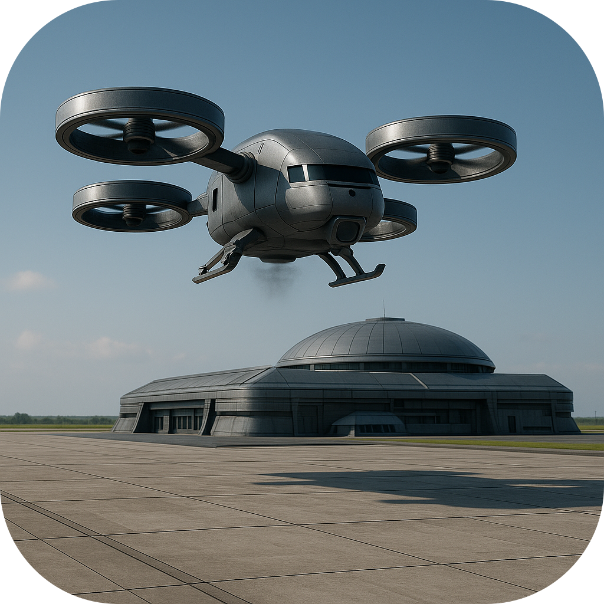

## Military

A colony's military is made up of **units** — battalions, squadrons, and fleets
recruited from the colony's own population at a **Barracks**, **Army Base**, **Joint Base** or **Naval Base**. Units are stationed in colonies, can be moved (rebased) between
your colonies, and are used to **attack** enemy colonies in a **strike force**.

Each unit has a **manpower strength** (its current size) that fills toward its
maximum (its *unit size*) as the home building recruits colonists into it. A
unit's fighting power scales with how full it is: a half‑manned unit fights at
half strength.

### Unit Types

Attack, Defense, and HP are the unit's values at **full** strength; a unit at
*s / max* manpower fights at that fraction. **Attack** is damage dealt,
**Defense** is damage mitigated per hit, and **HP** is how much damage the unit
can take before it is destroyed. **Size** is the manpower a full unit holds.
**Speed** sets travel time (`ceil(path cost / speed)` turns). **Range** limits
how far air and naval units can strike. **Based at** is where the unit may be
stationed.

| Unit | Size | Attack | Defense | HP | Speed | Range | Based at |
|------|-----:|-------:|--------:|---:|------:|------:|----------|
| Infantry | 1,000 | 1 | 1 | 5 | 8 | — | Any colony |
| Armored (Tank) | 500 | 3 | 3 | 15 | 2 | — | Any colony |
| Fighter | 300 | 3 | 3 | 6 | 5 | 20 | Colony with an **Air Field** or **Airport** |
| Bomber | 300 | 5 | 1 | 4 | 4 | 40 | Colony with an **Airport** |
| Escort | 1,250 | 4 | 7 | 20 | 2 | — | Colony with a **Port** |
| Carrier | 6,000 | 12 | 5 | 25 | 3 | 30 | Colony with a **Port** |

- **Infantry** — a 1,000‑strong rifle battalion: dismounted troops armed with
  small arms, portable missiles, and light support weapons. Cheap, quick to
  raise, and the fastest ground unit on land thanks to hoovercraft that they employ for rapid deployment.
They are individually
  weak but rely on numbers — a swarm of battalions can
  overwhelm what no single one could. Crucially, Infantry are a **land** unit,
  and only land units (Infantry and Armored) can march in and **occupy or
  capture** a colony; air and naval forces can smash defenses but never hold
  ground. They can be stationed in **any** colony. No stealth — they advance in
  the open and are seen coming.

- **Armored** — a 50 tank strong battalion of heavy main‑battle tanks and
  fighting vehicles, with powerful cannon and reactive armor. Many times the
  attack and defense strength of Infantry, they win almost any straight ground
  fight — but their weight makes them the slowest unit in the game, so
  they lumber to the front. As a **land** unit they can occupy and capture
  colonies, making them the ideal spearhead: send Armored to break the defense
  and Infantry to garrison what you take. Stationable in **any** colony.

- **Fighter** — a squadron of fast air‑superiority stealth jets armed with cannon and
  air‑to‑air and air‑to‑ground missiles. Balanced in attack and defense
  and quick in the air, they strike hard for their size but are
  fragile if caught on the ground. Fighters must be based at a colony with an
  **Air Field or Airport**, and can only join a strike against a target within
  their **range of 20** of the staging colony — a defensive and short‑reach
  offensive weapon. Being aircraft, they overfly terrain and cannot themselves
  hold ground.

- **Bomber** — a squadron of heavy strategic stealth bombers carrying stand‑off missiles
  and precision ordnance. They hit the hardest of any air unit but
  are lightly protected — devastating on the attack, vulnerable if
  intercepted. With the **longest air range** they can reach deep targets
  no fighter could, but they need the larger facilities of an **Airport** to
  base and arm at. Use them to crack a colony's defensive systems before your
  land force arrives.

- **Escort** — a naval task group of stealth cruisers, destroyers, a submarine, and a
  supply ship, bristling with anti‑ship, anti‑air and
  anti-submarine systems. Built for survival with
  a modest attack, the escort's role is **sea control**: its submarine
  element gives it a measure of **stealth and screening** that makes it the
  counter to enemy fleets. Escorts must be based at a **Port** and fight only at
  sea — they may attack **only** a target defended by enemy naval units (Escorts
  or Carriers), hunting fleets rather than bombarding the shore. They move slowly.

- **Carrier** — a 100 aircraft strong carrier battle group: a flattop with its embarked
  air wing (around five squadrons) carries the
  heaviest punch of any unit thanks to its aircraft reaching far
  beyond the hull, though the carrier itself is only moderately armored and depends on its screen for protection. Based only at a **Port**,
  it projects power from the sea onto the land: it can strike any coastal colony
  within its **range of 30** of the nearest coast it can reach by sea from its
  home port — the one naval unit able to assault a shore. Being a fleet, it
  cannot occupy ground; pair it with a land force to take what it batters.

### Upkeep

Each built unit draws a yearly **upkeep** (Food/Goods/Energy/Water/Wealth), paid
by its **home colony**, scaled by how full it is (a half‑strength unit pays half
upkeep). If the home colony can't cover it, the shortfall is borrowed from the
**Federation** and connected colonies like any other colony need.

### Defensive Systems

Defensive systems protect a colony from enemy strike forces. Each has its own **HP** (how much damage it can take before it is destroyed) and a **Defense** rating that mitigates each incoming hit. They are **purely defensive** — they soak up and reduce an attacker's blows but deal no damage back. When a defensive system's HP is beaten down to zero in battle it is destroyed and removed; HP and defense are restored to full each turn, so a colony that survives an assault stands ready again next year. All require a **Factory** first and may be built on any land within a colony's control. Defensive systems are classified as buildings in Zubrenn and are built per colony and remain in the colony where they originated. A colony's defenses stack: all of its defensive systems **plus** any stationed units defend it together.

#### Missile Battery

The Missile Battery is the entry‑level colony defense — racks of guided interceptors that pepper an incoming strike force. Cheap and quick to raise with light upkeep, it needs only a modest colony population to field. It contributes a small amount of defense strength, enough to blunt a light raid or to buy time while heavier defenses or a relief force are brought up.

#### Laser Battery

The Laser Battery trades missiles for directed‑energy weapons — banks of high‑powered lasers that burn through attackers at the speed of light. A little pricier than the Missile Battery and hungrier for power, and requiring a somewhat larger colony, it returns noticeably more defense strength. It is the natural step up for a colony expecting more than a token assault.

#### Electro-Magnetic Shield

The Electro‑Magnetic Shield throws a crackling energy barrier over the colony, soaking up tremendous punishment before it fails. A major build with a heavy, continuous power draw and a sizable population requirement, it contributes a large block of defense strength — far more than the gun batteries — making a shielded colony a hard target that an attacker must grind down before anything behind it can be touched.

#### Plasma Bubble

The Plasma Bubble is the ultimate colony defense — a seething dome of contained plasma that all but encases the settlement. It is built as an **upgrade of an existing Electro‑Magnetic Shield**, raised in its place, and demands a large, mature colony and a steep, ongoing investment of power and wealth to sustain. In return it contributes an enormous block of defense strength, enough to turn back all but the most overwhelming strike force. For a frontier capital or a prized industrial world, the Plasma Bubble is the last word in protection.

### Intelligence Gathering

#### Drone Base

The Drone Base is a self‑contained forward reconnaissance outpost that can be placed on almost any explored cell, even far outside a colony's borders, peeling back the fog of war over a wide area and giving real‑time intelligence on neighboring colonies. Powered by its own solar panels and linked wirelessly to the nearest colony, it is funded — in both construction and upkeep — by the Federation rather than any single colony. Deployment relies on route planning: the base travels overland from the nearest colony, so rougher, farther sites take longer to come online, with roads and monorails speeding the journey; it can cross shallow sea only when a Dock is present. It produces nothing and stores nothing — its sole purpose is sight.

### How Combat Works

Combat happens when you launch a **strike force** against an enemy colony.

**1. Form the strike force.** Right‑click an enemy colony's biodome and choose
**Launch Attack**. The *Form Strike Force* dialog lists your colonies, nearest
to the target first, and under each the units that are **eligible** to attack
this target (air units in range, naval units able to reach the coast, land units
anywhere). Check the units to send and give the force a name.

**2. Assemble and travel.** The chosen units first **rally** at the participating
colony closest to the target, each travelling at its own speed. Once the whole
force has gathered, it advances to the target together, arriving after the
**slowest** unit's travel time. The Military screen shows each unit's attack
status and the turns remaining.

**3. The battle.** On arrival the strike force fights the colony's defenders —
its stationed units plus its defensive buildings. Every combatant carries three
values: **Attack** (damage dealt), **Defense** (damage mitigated per hit), and
**HP** (its health pool). For units these scale with manpower, so a half‑manned
unit has half the attack, defense, and HP of a full one; a defensive building
uses its own HP and Defense and deals no damage. The battle is fought in
**rounds**:

- Each round, the strongest attackers are paired against the toughest defenders.
  Both sides strike **simultaneously**.
- Each hit deals **damage = max(0, attacker's Attack × a random factor − the
  defender's Defense)**. The random factor is ±30% by default, so no battle is
  perfectly predictable, and heavy armor can shrug off light attacks entirely.
  That damage is subtracted from the defender's **HP**.
- Defending **units** strike back the same way. Defensive **buildings** only
  absorb — they never damage the attackers.
- A combatant whose **HP reaches zero** is removed: a destroyed unit is lost
  from the game, and a destroyed defensive building is torn down and removed from
  the colony. Surviving units keep the share of manpower equal to their
  remaining HP fraction.

Rounds continue until one side has no combatants left (or a safety cap is
reached, in which case the attacker withdraws).

**4. The outcome.** If the attacker destroys every defender and defensive
building, the colony falls and you choose what to do with it:

- **Capture** — the colony (and its surviving buildings) becomes yours, but
  **10–30%** of its non‑biodome buildings are destroyed in the fighting.
  Capturing requires at least one surviving **land** unit (Infantry or Armored)
  to occupy it.
- **Raze** — every building, **including the biodome**, is destroyed. Razing a
  colony is seen as a brutal act: it **lowers every other species' opinion of
  you** (see Diplomacy, below).
- **Leave** — if you have no land units left to occupy a defeated colony (or
  simply choose not to take it), the colony is left **neutral** (ownerless) until
  another land‑bearing strike force claims it.

If the defenders win, the surviving attackers withdraw to their home base.

### Diplomacy

Every player (you and each alien species) holds an **opinion** of every other,
from **−100** (hostile) to **+100** (friendly), starting at **0**. Aggressive
acts such as **razing** a colony lower others' opinion of you. You can review how
each species currently regards you in the **Diplomacy** screen (View ▸
Diplomacy).
