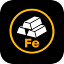
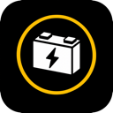

## Resources

A colony's economy turns on eight resources. Seven are stockpiled commodities —
**Energy**, **Food**, **Goods**, **Material**, **Water**, **Wealth**, and
**Population** — and the eighth, **Happiness**, is a morale level that drives
whether the population grows or shrinks. Each turn a colony produces and consumes
these resources across its worked tiles and buildings; surpluses are stored (up
to a colony's storage caps) or overflow to the Federation, while shortfalls are
covered by borrowing from connected colonies or, failing that, by idling
buildings. The sections below describe each resource, its display abbreviation,
and the units it is measured in.

#### Energy

**Energy** (abbreviated **E**, measured in gigawatt-hours, **GWHr**) is the
electrical power generated by Solar Panels and energy deposits worked across the
colony. It runs factories, buildings, and transport, and most structures draw a
yearly energy upkeep. When a colony cannot meet its energy demand, buildings are
forced to **idle** until supply recovers — so a steady power surplus is the
foundation of a productive colony.

#### Food

**Food** (abbreviated **F**, measured in kilotonnes, **kt**) is the edible
biomass harvested from worked tiles and Farms. Colonists consume food every year
in proportion to the population, and the balance between what is grown and what
is eaten directly drives **Happiness** and therefore **Population** growth: a
healthy food surplus lifts morale and swells the colony, while a deficit saps
both.

#### Goods

**Goods** (abbreviated **G**, measured in kilotonnes, **kt**) are the
manufactured consumer and commercial products turned out by Factories, which
convert raw **Material** into finished goods. Goods are spent constructing
buildings, transport, and new colonies, and are steadily consumed by the
population and industry. A colony that mines plenty of Material but lacks the
Factories to work it will find itself rich in raw stock yet short of the goods
that actually build and sustain a civilization.

#### Material

**Material** (abbreviated **M**, measured in kilotonnes, **kt**) is the raw and
refined building stock mined and gathered from the land — ore, stone, timber,
and the like. On its own it is an input rather than a finished product: Factories
consume Material to manufacture **Goods**. Stockpile Material in Depots and feed
it to your factories to keep the goods flowing.

#### Water

**Water** (abbreviated **W**, measured in gigalitres, **GL**) is the fresh water
drawn for colonists and industry from rivers, canals, wells, and purification
plants. It is consumed each year to sustain the population and keep production
running, making a reliable water supply essential for any colony that hopes to
grow — especially in arid regions, where Water Treatment and Desalination Plants
earn their keep.

#### Wealth

**Wealth** (abbreviated **¤**, measured in millions of credits, **M¤**) is the
colony's accumulated economic value. It pays building upkeep and construction
costs and is spent by consumers and industry alike. Wealth is produced by trade,
Banks, and luxury terrain bonuses, and the Federation's treasury is simply its
pooled Wealth — the lifeblood of taxation, maintenance, and expansion.

#### Happiness

**Happiness** (abbreviated **H**, measured as a percentage, **%**) is a colony's
morale. It reflects how well the colony is provisioned and developed — how
reliably its people are fed and supplied, and the civic and industrial character
of what you build around them. Positive happiness grows the population while
negative happiness shrinks it, so morale is the dial between a thriving,
expanding colony and one in decline.

#### Population

**Population** (abbreviated **P**, measured in thousands, **k**) is the lifeblood
of the colony — the colonists who work its farms, mines, and industry to grow the
civilization. The number of tiles a colony can work scales with its population,
and population itself grows or shrinks each turn according to **Happiness** and
the growth bonuses of its worked cells and buildings. Nurture your population and
the rest of the economy follows.

## Strategic Resources

Beyond the eight everyday resources, the planet holds **strategic resources** —
special materials found only in certain **terrain bonuses**. Unlike the stockpiled
commodities, a strategic resource is not banked or traded by the tonne; it is
either **available** to you or not. A strategic resource counts as available while
at least one terrain bonus carrying it is **worked by one of your colonies** or
covered by one of your **Outposts**. Many advanced buildings and military units
can only be built while you hold the strategic resources they demand (shown in the
**Strategic Resources** panel on the main screen). There are seven:

#### Aluminum

A light, strong structural metal, smelted from **Bauxite Seams**. Aluminum is the
workhorse of flight and space: it is required for the **Air Field** and **Airport**,
the **Launchpad** and **Spaceport**, the **Satellite Network**, and the **Missile
Battery** — and for building **Fighters**, **Bombers**, **Carriers**, and **ICBMs**.
Few civilizations get far into the air or orbit without it.

#### Crystal

Piezoelectric and superconductive crystals, harvested from **Kinetite Crystals**,
**Sunshard Flats**, **Quakecrystal Lodes**, and **Celestite Spires**. Crystal is the
heart of advanced electronics and directed energy: it is required for the
**Nanofactory**, the **Launchpad** and **Spaceport**, the **Satellite Network**, and
the energy defenses (**Laser Battery**, **Electro-Magnetic Shield**, **Plasma
Bubble**) — and for **Fighters**, **Bombers**, **Escorts**, **Carriers**, and
**ICBMs**.

#### Iron

A dense, abundant metal ore, mined from **Ferric Strata Veins**, **Starfall Alloy
Craters**, **Gravalloy Veins**, and gathered from **Ironcap Mushrooms**. Iron is the
backbone of heavy ground and naval forces: it is required to build **Armored**
(tank) battalions, **Escorts**, and **Carriers**. Common enough that most colonies
can find a vein, it is the first strategic resource a militarizing empire secures.

#### Lithium

A battery metal concentrated in the **Lithium Brine Deposit** of arid salt flats.
Lithium powers large-scale energy storage: it is required for the **Solar Salt
Works** (which extracts it) and for **Grid Storage**, the utility-scale battery
bank. Lithium is also required for the **Satellite Network**.  A colony that means to bank its surplus power needs a worked lithium source.

#### Stone

Quarried construction aggregate, cut from **Fossilized Chitin Reefs** and
**Threadstone Seams**. Stone is the strategic resource of overland infrastructure:
a worked stone source is required to build **Roads** and **Monorails**. Without it,
a colony cannot pave the overland transport network that links it to its neighbors.

#### Titanium

An exceptionally strong, lightweight structural metal, refined from **Titanlace
Deposits** and salvaged from a **Buried Starship Hull**. Titanium is reserved for
the most demanding builds: it is required for the **Launchpad** and **Spaceport**,
the **Satellite Network**, and for building **Fighters** and **Bombers**. Rare, and the mark of a
mature space-age civilization.

#### Uranium

A rare fissile mineral found in the **Uranium Deposit**. Uranium is the fuel of the
atomic age: it is required to build and run the **Nuclear Reactor** and to arm the
**ICBM**. A worked uranium source is the gateway to the largest power plant and the
most fearsome weapon on the planet.
