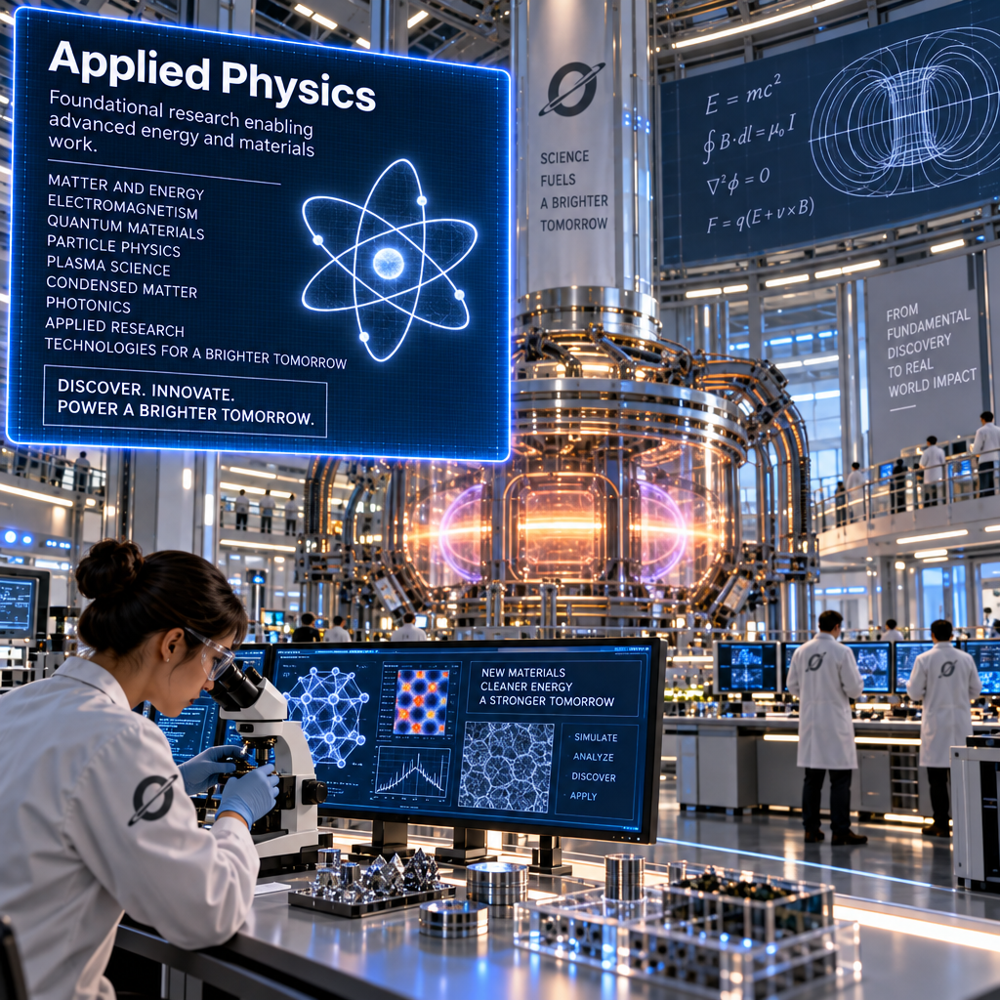
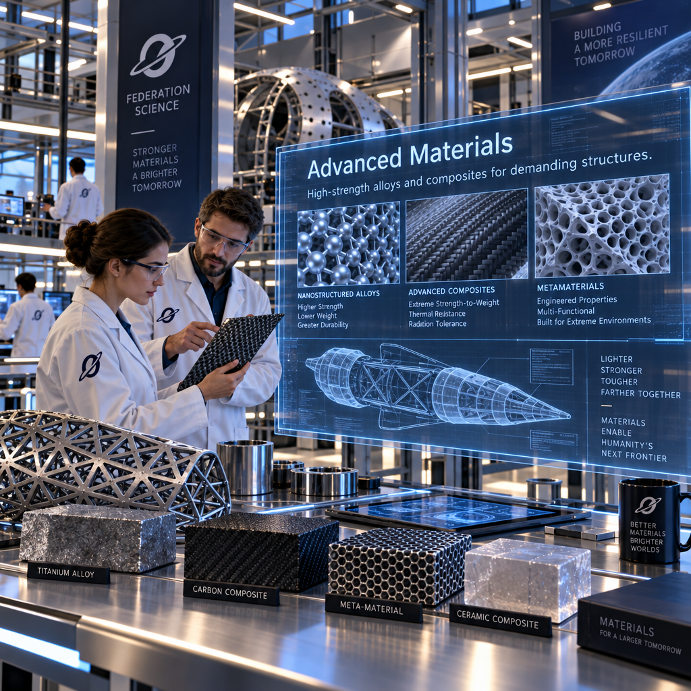
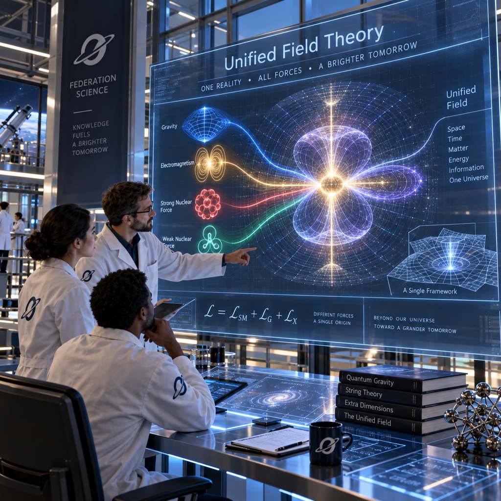
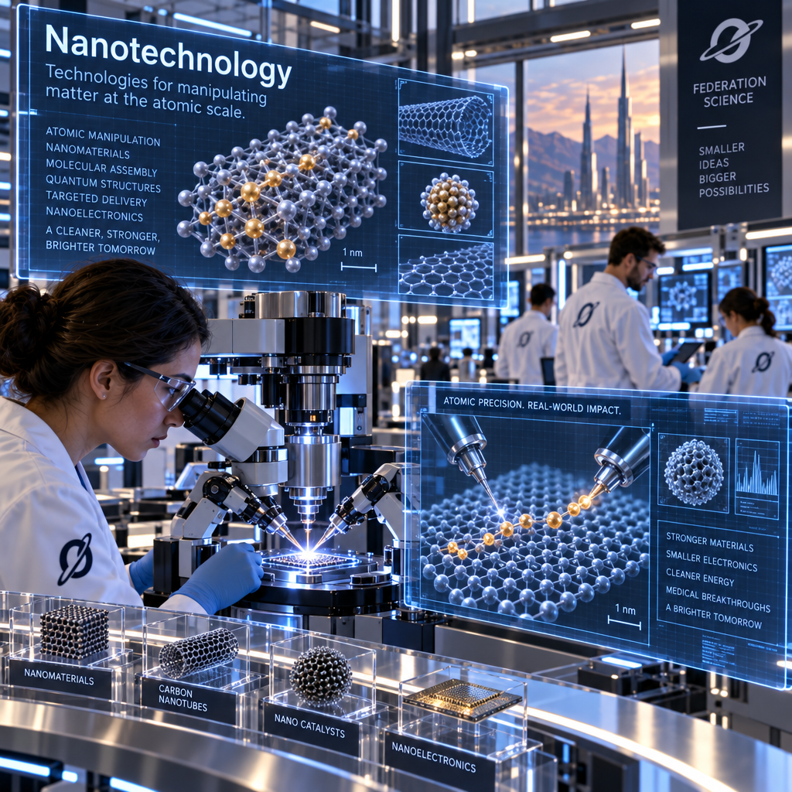
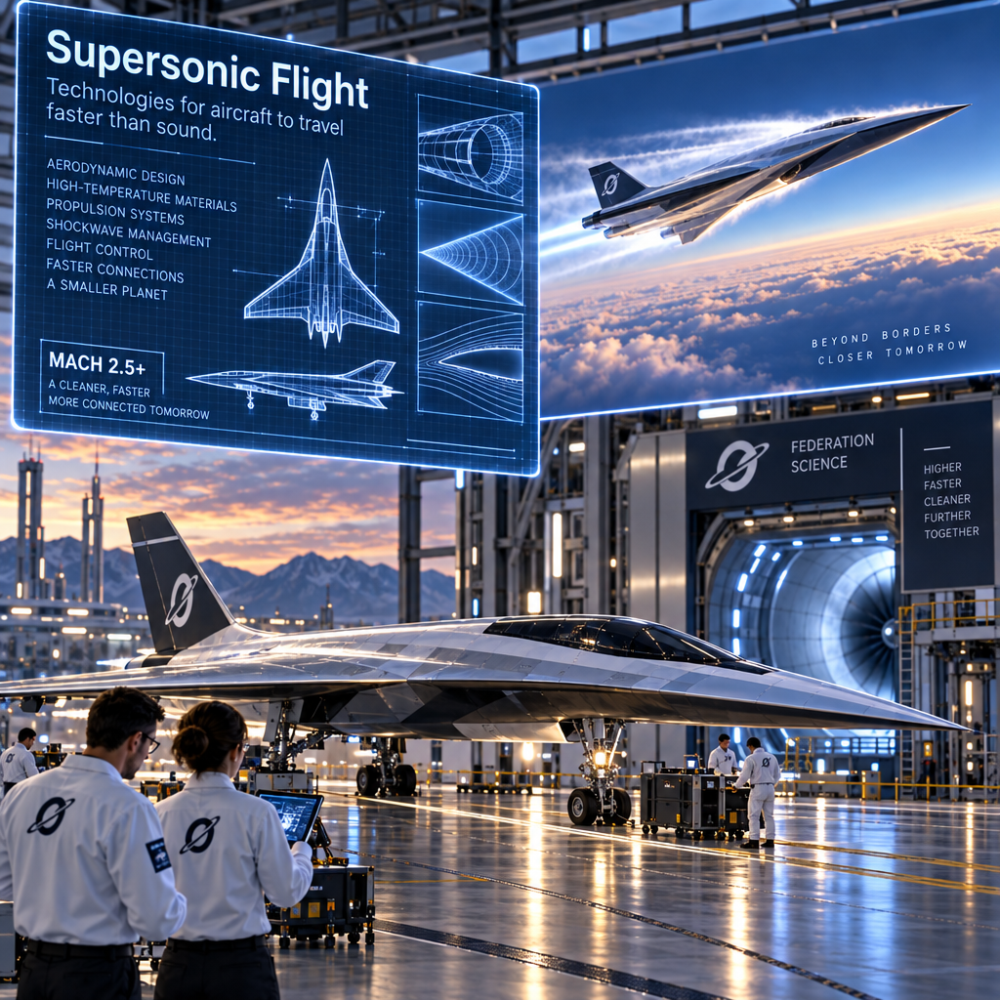
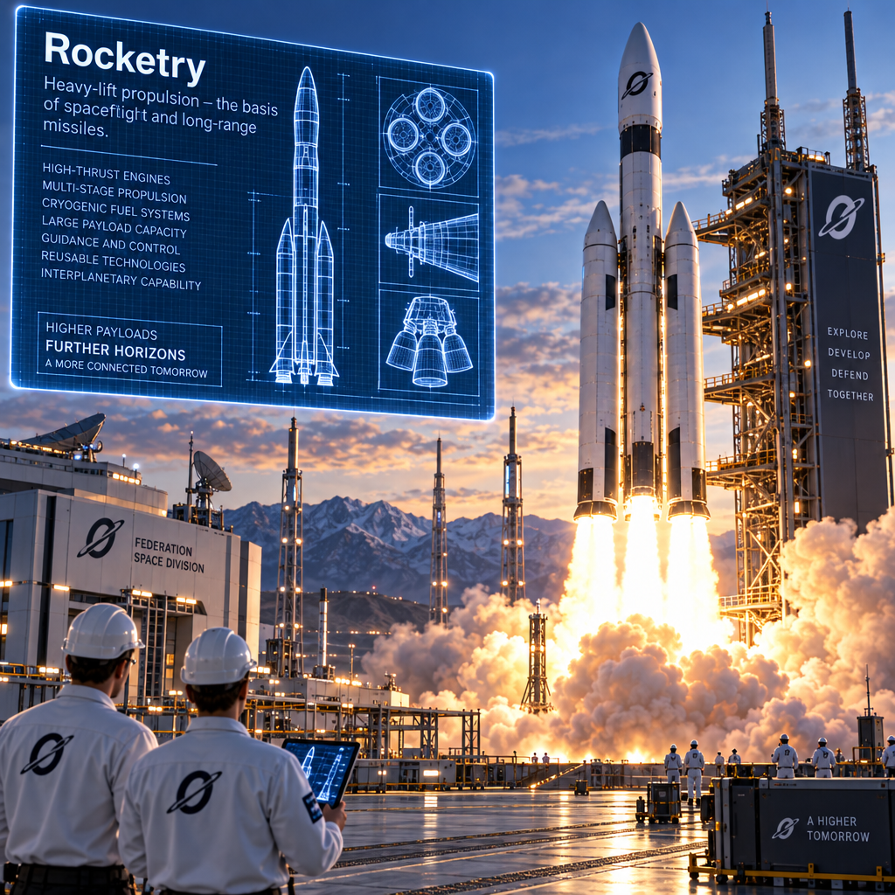
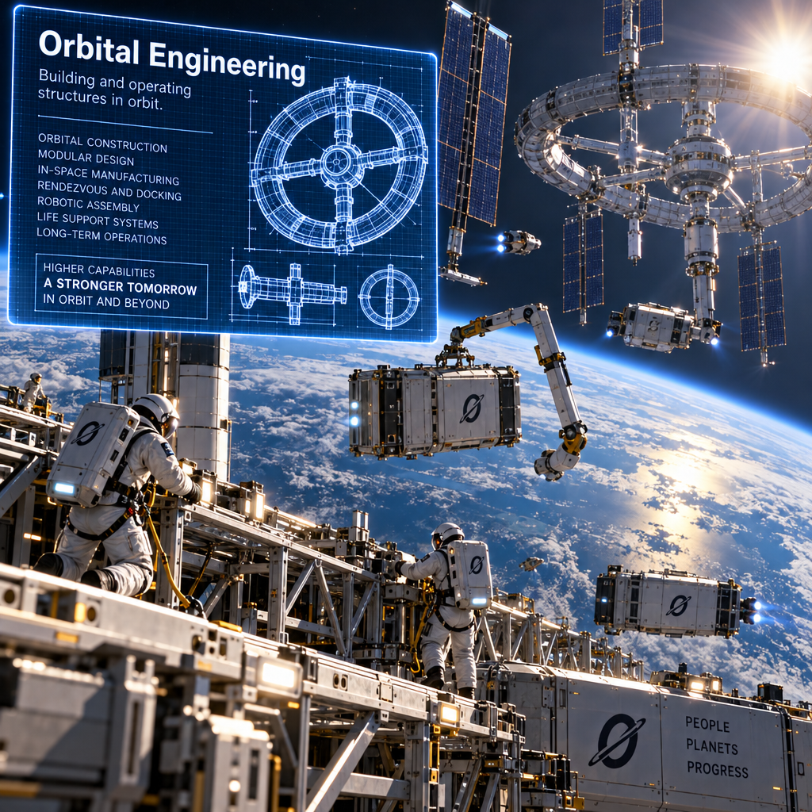
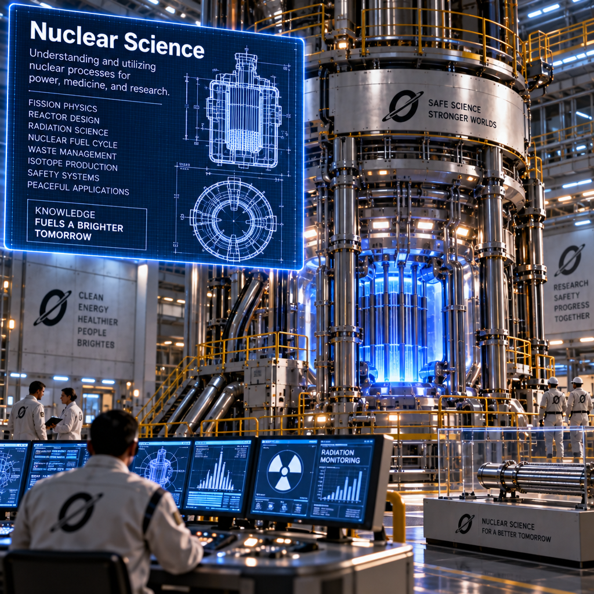
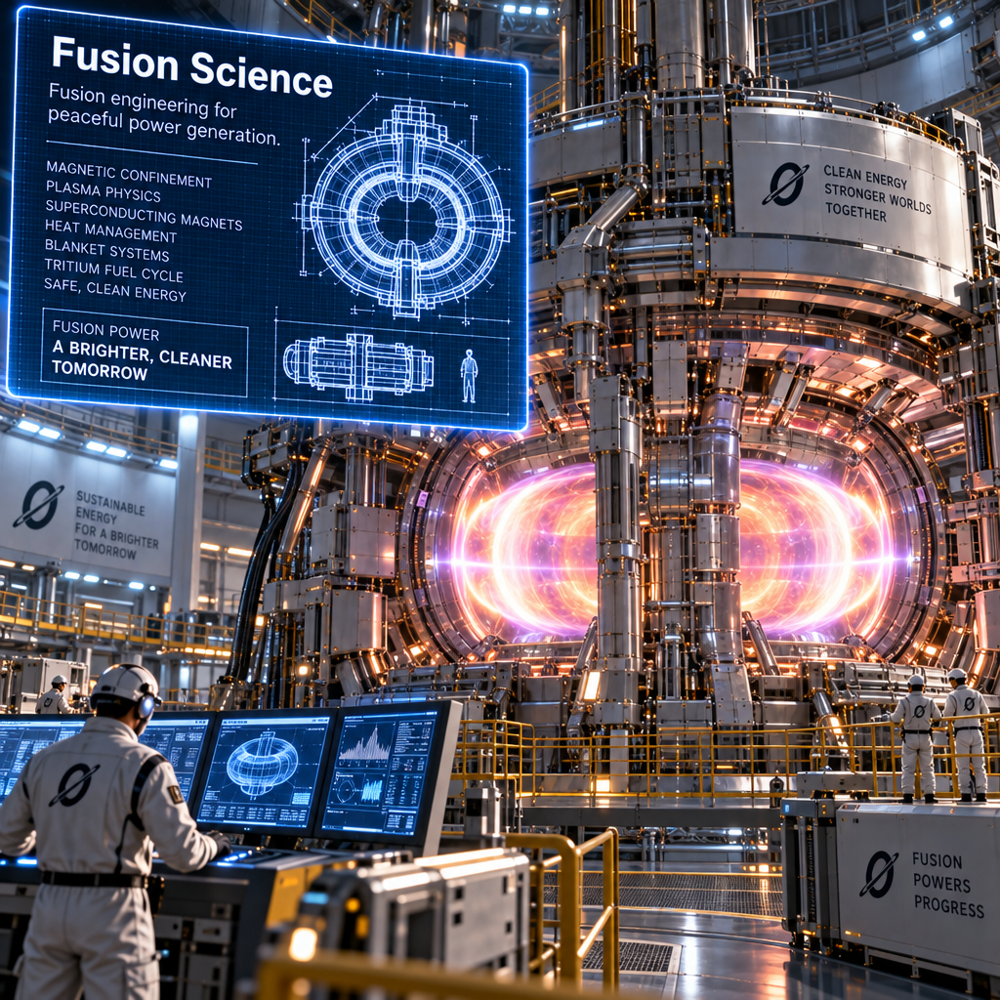

## Technology

Your Federation advances through a shared **technology tree**. Each year, science
funds your **current research** (overflow wealth plus up to the funding slider's
share of your stored wealth — spent only while a technology is actually
selected). Completing a technology **unlocks** the buildings and units that
require it, so research is how a civilization grows beyond its starting
capabilities. Technologies are researched one at a time; some require earlier
technologies as **prerequisites**. Open the **Research** screen (View ▸ Research)
to choose what to study next.

### Advanced Agricultural Science

Advanced techniques and technologies for farming and food production. A
foundational civic science with no prerequisites, it lifts the ceiling on how
much food the land can be coaxed to yield. **Cost: 4,000 science.** **Unlocks the
Aquafarm** — a high‑output coastal food works that feeds a large, growing
population where open farmland is scarce.

### Applied Physics

Foundational research enabling advanced energy and materials work. A root science
with no prerequisites, Applied Physics is the gateway to most of the tree — the
bedrock on which advanced materials, nanotechnology, flight, and field theory are
built. **Cost: 4,000 science.** **Unlocks the Solar Farm** (a sprawling array
that far outproduces a single Solar Panel) and the **Laser Battery** (a rapid
energy‑weapon colony defense).

### Advanced Economic Theory

Theories and models for understanding and predicting economic behavior. An
independent civic science with no prerequisites. **Cost: 7,000 science.**
**Unlocks the Global Bank** — the Bank elevated to a world financial center,
pouring out wealth and holding vast reserves for the whole Federation.

### Advanced Materials

High‑strength alloys and composites for demanding structures. **Requires Applied
Physics.** This is the central mid‑tree science — a prerequisite for
nanotechnology, flight, rocketry, orbital engineering, and nuclear science, and a
direct enabler of a broad slate of advanced works. **Cost: 7,000 science.**
**Unlocks** the **Wind Farm**, **Naval Shipyard**, **Grid Storage**, **Satellite
Network**, **Laser Battery**, **Electro‑Magnetic Shield**, and **Plasma Bubble**.

### Unified Field Theory

A theory that unifies the fundamental forces of nature. **Requires Applied
Physics.** A deep theoretical advance whose practical payoff is the most powerful
point defense the colony can field. **Cost: 10,000 science.** **Unlocks the Plasma
Bubble** — a top‑tier energy shield/defense.

### Nanotechnology

Technologies for manipulating matter at the atomic scale. **Requires Applied
Physics and Advanced Materials.** **Cost: 10,000 science.** **Unlocks the
Nanofactory** — the Factory's apex upgrade, producing goods and wealth on a scale
no ordinary factory can match (and the prerequisite for the Fusion Reactor).

### Supersonic Flight

Technologies for aircraft to travel faster than sound. **Requires Applied Physics
and Advanced Materials.** **Cost: 10,000 science.** **Unlocks the Airport** (the
Air Field's upgrade, extending air‑network reach) and the **Joint Base** (a
combined‑arms base that stations air and land forces together).

### Rocketry

Heavy‑lift propulsion — the basis of spaceflight and long‑range missiles.
**Requires Applied Physics, Advanced Materials, and Supersonic Flight.** The
threshold of the space age and of strategic weaponry. **Cost: 10,000 science.**
**Unlocks** the **Launchpad**, **Spaceport**, **Joint Base**, **ICBM Factory**,
**Satellite Network**, and **Missile Battery**, and the **ICBM** unit itself.

### Orbital Engineering

Building and operating structures in orbit. **Requires Advanced Materials and
Rocketry.** **Cost: 20,000 science.** **Unlocks the Satellite Network** — orbital
infrastructure that, once operational, reveals the world and extends your reach
across the planet.

### Nuclear Science

Fission engineering for reactors and strategic weapons. **Requires Advanced
Materials.** **Cost: 20,000 science.** **Unlocks the Fission Reactor** — the
pinnacle of pre‑fusion power, fueled by worked **uranium** — and (with Rocketry)
the **ICBM** warhead.

### Fusion Science

Fusion engineering for peaceful power generation. **Requires Nuclear Science** —
the deepest and most expensive technology on Zubrenn. **Cost: 40,000 science.**
**Unlocks the Fusion Reactor** — a star tamed in a bottle, the ultimate power
source: an upgrade of the Fission Reactor that needs no fuel at all and roughly
doubles its output.
