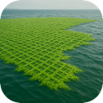
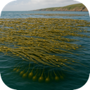
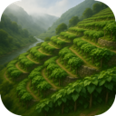
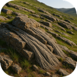
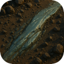
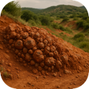
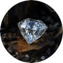

## Terrain Bonus

Scattered across the continent are special resource deposits that enrich the
land they occupy. Each favors certain terrain and climates — some cling to the
coast or riverbanks, some only to the high mountains or the frozen poles — and
some are far rarer than others. When a colony works a cell holding one of these,
it adds to what that cell provides: extra food, material, energy, wealth, or a
lift to morale. A few are pristine wonders that must be kept undisturbed to keep
their gift.

### Strategic Resources

Beyond their raw yields, certain deposits provide a **strategic resource** —
a special material type (such as *iron*, *stone*, *crystal*, *titanium*, or
*aluminum*) needed to build the most advanced units, buildings, and transport.
A strategic resource counts as **available to your whole Federation** as long as
**any one** colony is *working* a cell that provides it; it does not have to be
in the colony doing the building. Several different deposits can provide the same
strategic type (any one of them satisfies the requirement), and a thing that
needs more than one type needs a worked source of **each**. The table below lists
what each strategic resource unlocks and which deposits provide it:

| Strategic resource | Provided by | Required for |
| --- | --- | --- |
| **Stone** | Fossilized Chitin Reefs, Threadstone Seam | Roads, Monorails |
| **Iron** | Ferric Strata Veins, Starfall Alloy Crater, Gravalloy Veins, Ironcap Mushrooms | Armored (tank) battalions, Escorts, Carriers |
| **Crystal** | Kinetite Crystals, Sunshard Flats, Quakecrystal Lodes, Celestite Spires | Monorails; Laser Battery, Electro-Magnetic Shield, Plasma Bubble; Fighters, Bombers, Escorts, Carriers; Spaceport, Satellite Network |
| **Titanium** | Titanlace Deposit | Fighters, Bombers, Carriers; Spaceport, Satellite Network |
| **Aluminum** | Bauxite Seam | Monorails, Air Field, Airport, Missile Battery; Spaceport, Satellite Network; Nanofactory |

### Food

#### Myco-Tower Grove

The Myco-Tower Grove rises in the twilight band near the poles, where towering fractal fungi flourish in the long, dim seasons on grassland, hills, and even the edges of the ice, always within reach of water. Their branching, cathedral-like forms are farmed in the half-light, and their spores are threshed and refined into protein and starch. A worked grove is a solid source of food, making the cold frontier far more survivable than it first appears.

#### Microalgae Lattice

The Microalgae Lattice spreads across sheltered coastal seas within the temperate latitudes, a vast floating mesh of engineered microalgae clinging to the water near land. Skimmed and pressed, it becomes a reliable source of protein and carbohydrates for nearby colonies. A worked lattice is a strong source of food, turning quiet shallows into productive aquatic farmland.

#### Substrate Slime

Substrate Slime is a Zubrenn-native organism that films the banks of warmer rivers across grassland, hills, forest, jungle, and desert. Harvested from the riverside mud, the slime is processed into a dense, nutritious protein paste. A worked deposit is a solid source of food, rewarding colonies that settle along the planet's inland waterways.

#### Glacial Bloom

The Glacial Bloom is a rare wonder of the frozen zones: with each seasonal thaw the ice releases edible cryo-lichens that shimmer and glow softly through the polar night. Exceptionally scarce, these blooms are gathered quickly before the freeze returns. A worked bloom is a solid source of food, a precious lifeline in otherwise barren ice.

#### Chemosynthetic Vent Colonies

Clustered around geothermal seeps in the low and high mountains, Chemosynthetic Vent Colonies are thickets of tube-worm analogs that feed on mineral-rich heat rather than sunlight. Entirely self-sustaining, they offer a dependable harvest even in the harshest stone. A worked vent field is a modest source of food, letting mountain colonies draw sustenance from the depths.

#### Veyra Pods

Veyra Pods grow on hardy native plants that dot the grasslands and hills, bearing dense clusters of protein-rich seed pods. Tough and widely distributed, they are among the easiest wild foods for a young colony to gather. A worked stand is a modest but steady supplement to early agriculture.

#### Cloudkelp Beds

Cloudkelp Beds drift in the coastal seas near land, where buoyant fronds spread into dense floating canopies above nutritious underwater bulbs. Both the surface growth and the submerged tubers are harvested in turn. A worked bed is a modest source of food, giving seaside colonies another reason to look to the water.

#### Morrowback Herds

Morrowback Herds roam the open grasslands and plains, great bovine-like grazers whose swollen nutrient sacs can be tapped and harvested without harming the animals. Herded rather than hunted, they provide a renewable, humane source of rich sustenance. A worked range is one of the most generous sources of food on the continent. food bonuses on the continent.

#### Bugalo Grazing Range

The massive, bison-sized beetle *Bugalo zubrennensis* migrates in slow herds across the twilight steppes of the grasslands, hills, and plains. The meat is perfection: buttery, marbled, and objectively tastes like Kobe beef. The problem is the color. The green iridescent carapace pigment bleeds through the muscle, leaving the meat a vivid, unappetizing chartreuse no matter how it is cooked. Colonists will eat it, but chefs hate it. A worked range is a generous source of food and brings a little wealth and cheer besides.

#### Cragwing Flock

Cragwing flocks roost on sheer, sun-baked crags — the rocky cliffs of the high mountains and the broken bluffs of the highland hills. These lizards show a vivid colour gradient with altitude: the  lowland-hill variety is a deep, rusty **red**, while the high-mountain variant is a brighter **orange**, and locals read a crag's elevation from the hue of its flock. They bask for hours in direct sunlight and will not tolerate forest or shade, so you will never find them beneath the canopy. Thrive in any climate but the polar ice.

Despite the name and their broad, membranous "wings," cragwings cannot truly fly. They are explosive **jumpers**: a startled lizard launches itself nearly three metres straight up, snaps its wings taut, and glides to the next ledge to escape a predator. The trick is costly — their small bodies tire almost instantly, so after one or two good leaps the animal goes stiff and **catatonic**, splayed and helpless on the rock. A persistent hunter simply follows, waits out the second jump, and collects the exhausted quarry by hand. Mind the mouth: a cragwing's teeth are razor-sharp and it will bite to the bone before it tires. The pale meat is the prize — tender, mild, and tasting, unmistakably, of chicken. A worked crag is a dependable, fairly abundant source of food across Zubrenn.

#### Thousandseed Basin

The Thousandseed Basin forms in the wetlands, where seasonal floods trigger extraordinary blooms of fast-growing, seed-bearing organisms. When the waters recede, colonists gather the countless seeds in a brief, bountiful harvest. A worked basin is a generous source of food, turning the marshes into one of the planet's richest larders.

#### Fishery

A Fishery marks the rich shoaling grounds where Zubrenn's native sea-life gathers thick enough to net, found in any stretch of sea. Reliable and easy to work from the shore, these waters feed coastal colonies through every season. A worked fishery is a solid source of food, the dependable catch that sustains a seafaring people.

#### Thaelrunners

Thaelrunners are blubber-rich, seal-like pinnipeds that haul out in great rookeries across the frozen coasts, their sleek bodies built for the ice and the cold water beneath it. A colony may harvest them for a generous yield of food — but the slaughter troubles the settlers, who grow uneasy at the thinning of the herds. Left in peace, the gathered Thaelrunners are instead a beloved sight that lifts morale. Worked, they are a solid source of food at a small cost to happiness; unworked, they quietly cheer the colony.

#### Vorndeeps

Vorndeeps are the vast, migratory leviathans of Zubrenn's open ocean, sounding through the deep waters far from any shore. Hunting them yields a bounty of food, yet their loss weighs heavily on colonists who revere the giants. A colony that leaves the Vorndeeps unmolested finds its spirits lifted by their passage instead. Worked, they are a solid source of food at a small cost to happiness; unworked, their presence gladdens the people. (Reaching them requires a colony able to work the deep sea.)

#### Fingerfruit

Fingerfruit grow in heavy clusters of sweet, finger-shaped pods high in the jungle canopy, ripening year-round in the tropical warmth. Easy to gather and prized at every table, they feed colonists and brighten their days. A worked grove is a solid source of food and lifts morale besides, a cheerful staple of jungle colonies.

#### Thundergrass Prairie

Thundergrass Prairie rolls across the open grasslands and plains of the temperate and subpolar belts, a grain-analog named for the rushing sound its tall stalks make under the wind. Its defining trait is speed: cut or grazed, the prairie regrows within days, so a single field can be harvested again and again through the long growing season. Hardy and self-seeding, it needs no tending beyond the reaping. A worked prairie is a generous source of food, the breadbasket of any colony that claims the open steppe.

#### Sunpetal Orchards

Sunpetal Orchards grow across warm grasslands and plains, where groves of nectar-fruit trees track the sky and open their broad blossoms at each of Zubrenn's two sunrises. The twin bloom yields a double harvest of sweet, fragrant fruit, and the orchards' flowering has become the centerpiece of local celebration — colonies time their harvest festivals to the petals' opening. A worked orchard is a solid source of food and lifts morale besides, feeding the colony's tables and its spirit alike.

#### Mistvine Terraces

Mistvine Terraces cling to the river-cut slopes of hills and low mountains in the warmer latitudes, where generations of cultivation have carved the land into stepped ledges of climbing vine. The vines are water-wise marvels: their leaves condense the valley fog into runnels that trickle down the terraces, watering the crops below and filling the colony's cisterns with the overflow. A worked terrace is a solid source of food and a steady supplement of fresh water, letting slope-side colonies thrive where flat ground is scarce.

### Material

#### Ferric Strata Veins

Ferric Strata Veins are banded iron-silicate seams laid bare by relentless stellar winds, common across hills and both mountain tiers where basalt shelves break the surface. Easily located and widely spread, they are the backbone of early industry. A worked vein is a reliable source of material, feeding the forges of any mining colony.

#### Kinetite Crystals

Kinetite Crystals are piezoelectric minerals that form only in the natural vibration fields of hills and low mountains, growing slowly and sparsely over ages. Their charge-holding structure makes them invaluable for both electronics and resilient construction. A worked deposit is a good source of material, a rare but prized find.

#### Fossilized Chitin Reefs

Fossilized Chitin Reefs are the mineralized remains of ancient megafauna, now entombed in shallow seas near land. Mined and refined, their chitinous matrix becomes high-grade carbon composite. A worked reef is a good source of material and a little wealth, pairing structural value with a tidy profit from the exotic compounds it yields.

#### Aero-Silk Nests

Aero-Silk Nests are spun by alien arachnoid creatures that thrive in the low-humidity air of the deserts, where they draw out high-tensile fiber across the dunes. The harvested silk is both a construction marvel and a luxury export. A worked nest is a good source of material and a little wealth, letting arid colonies turn emptiness into advantage.

#### Starfall Alloy Crater

A Starfall Alloy Crater marks where a meteor struck Zubrenn, scattering rare earths and nickel-iron across grassland, hills, forest, jungle, desert, and both mountain tiers. These impact sites are extraordinarily rare but staggeringly rich. A worked crater is an exceptional source of material, a windfall of refined-grade metal for any colony fortunate enough to claim one.

#### Threadstone Seam

The Threadstone Seam runs through grassland, low mountains, and plains, a naturally fibrous rock that cleaves into long, useful construction strands with little processing. Reasonably common, it is a staple of large-scale building. A worked seam is a rich source of material, giving industrial colonies a steady supply of ready-to-use structural fiber.

#### Hexabark Grove

The Hexabark Grove is a stand of towering organisms that armor their trunks in lightweight, honeycombed plating, found across grassland, low mountains, and plains. Harvested like timber but strong as alloy, hexabark is a prized building material. A worked grove is a rich source of material, blending the ease of forestry with the strength of metal.

#### Gravalloy Veins

Gravalloy Veins thread through the low and high mountains, carrying an unusually dense metallic ore prized for heavy machinery and orbital infrastructure. Mining it is demanding, but the payoff is substantial. A worked vein is a rich source of material, the metal of choice for a colony's most ambitious engineering.

#### Titanlace Deposit

Titanlace Deposits form only in the high mountains, where rare mineral lattices can be processed into an exceptionally strong structural mesh. Reaching them means braving the planet's most forbidding peaks. A worked deposit is a rich source of material, rewarding high-altitude mining with some of the finest building stock on Zubrenn.

#### Bauxite Seam

Bauxite Seams are broad beds of aluminium-rich ore exposed across the hills and the low and high mountains — aluminum is the most abundant metal in Zubrenn's crust, just as on Earth, so the seams are common. Smelted into light, corrosion-resistant metal, their output is the backbone of aircraft, launch vehicles, and orbital works. A worked seam is a rich source of material and, crucially, the Federation's supply of **aluminum** — the strategic resource that unlocks Air Fields, Airports, Missile Batteries, and (with titanium and crystal) the Spaceport and Satellite Network.

#### Ironcap Mushrooms

Ironcap Mushrooms sprout in the shaded loam of forests and jungles across the tropical and temperate zones, where their roots draw dissolved metals up out of the soil. Over a season the fungi concentrate that metal into dense, dull-grey caps so hard they ring when struck — and so rich that colonists smelt them exactly as they would raw ore. Easy to gather and quick to regrow, an ironcap stand is a convenient alternative to deep mining. A worked patch is a good source of material, letting woodland colonies forge without ever opening a quarry.

#### Saltglass Pans

Saltglass Pans spread across the baked floors of the deep desert, vast evaporite flats left behind by ancient seas. Beneath the crust lie layered industrial minerals, and within it grow sheets of naturally fused translucent salt — "saltglass" — prized by traders for ornament and precision optics. Harvesting is simple: the sun does the refining, and crews need only cut and haul. A worked pan is a good source of material with a little wealth besides, turning the emptiest wastes into a working quarry and a trade good at once.

#### Quakecrystal Lodes

Quakecrystal Lodes form deep in the low and high mountains along fault lines, where crystals slowly absorb the strain of shifting rock and lock it away as stored charge. Rare and dangerous to extract — a mishandled crystal can discharge violently — the lodes repay the risk twice over: the mineral itself refines into a superb structural mesh, and the energy bled from it feeds the colony's grid. A worked lode is a rich source of material and a strong source of energy, a demanding prize for a well-prepared mountain colony.

#### Celestite Spires

Celestite Spires rise only from the highest mountain peaks, towering pillars of pale superconductive crystal that gather the charge of passing storms and glow faintly in the thin air. They are among the rarest finds on Zubrenn, reachable only by colonies willing to work the planet's most forbidding heights. Each spire yields three gifts at once: ultra-premium alloy milled from the crystal, raw power channelled from the storms it catches, and a handsome return on the exotic surplus. A worked spire is a strong source of material, energy, and wealth together, a crowning reward for high-altitude mastery.

### Water

#### Natural Spring

A Natural Spring wells up through fractured rock on dry grassland, hills, plains, forest, and low mountains, far from any river or coast. For inland colonies with no waterway to draw on, such a spring is a quiet lifeline. A worked spring is a steady source of fresh water, keeping dry-country settlements alive.

#### Glacial Meltwater

Glacial Meltwater runs clear and cold off the frozen ice sheets, pooling in dry hollows where the seasonal thaw gathers. In the barren polar wastes it is one of the few dependable sources of clean water. A worked meltwater field is a steady source of fresh water, sustaining colonies that brave the ice.

#### Oasis

An Oasis is a spring-fed pool ringed with greenery, an unexpected reservoir hidden among the dry dunes of the desert. Where water is the scarcest of all resources, an oasis transforms a hostile waste into habitable ground. A worked oasis is a generous source of fresh water, the beating heart of any desert colony.

#### Stormroot Taproots

Stormroot Taproots anchor the drier reaches of tropical jungle and wetland, native plants whose immense roots drive far down to tap aquifers no well could reach. During the storm season they pump far more water than the plant can use, and the surplus wells up around their crowns into clear, drinkable pools. For colonies on ground that looks lush but drinks poorly, the stormroots are a hidden reservoir. A worked stand is a steady source of fresh water, drawing the deep aquifer up to the surface where colonists can use it.

#### Verdant Hot Springs

Verdant Hot Springs bubble up among the hills and low mountains, mineral-warmed pools fringed with lush, steam-fed greenery that stays bright even in the cold months. The water is both a dependable supply and a cherished retreat: colonists bathe, gather, and rest at the springs, and the sites become beloved landmarks. Their charm depends on being left pristine — foul the surroundings and the greenery withers. A worked, undisturbed spring is a steady source of fresh water and lifts morale besides, a rare pairing of utility and delight.

### Energy

#### Tidal Dynamo Basin

A Tidal Dynamo Basin captures the powerful coastal flows driven by the orbits of Zubrenn's twin stars, where sea meets land. Rare and site-specific, these basins drive turbines around the clock. A worked basin is a strong source of energy, a clean and relentless power source for seaside industry.

#### Geothermal Plume

A Geothermal Plume vents the deep heat of the planet beneath the crustal plates of the low and high mountains. Reliable and potent, it demands careful cooling infrastructure to tap safely. A worked plume is a strong source of energy, anchoring mountain colonies with dependable baseload power.

#### Sunshard Flats

Sunshard Flats glitter across the open deserts, where naturally photovoltaic crystals carpet the ground and convert starlight directly into harvestable current. Common where the suns beat hardest, they turn the desert's greatest hardship into its chief asset. A worked flat is a strong source of energy, electrifying arid colonies with ease.

#### Pyrogel Pool

Pyrogel Pools lie beneath sealed surface crusts in the warmer wetlands, where native microbes brew a stable, energy-rich gel. Carefully extracted, the gel burns clean and steady. A worked pool is a strong source of energy, giving marshland colonies a surprising powerhouse hidden just below the surface.

#### Aurora Spires

Aurora Spires are conductive mineral towers rising from the frozen polar zones, where they channel powerful atmospheric currents down into fixed collection sites. Born of the same forces that paint the polar skies, they shine with captured charge. A worked spire is a strong source of energy, lighting the colonies that dare to settle the ice.

#### Driftglass Dunes

Driftglass Dunes ripple across the open desert, their sands fused by ages of wind and heat into drifting lenses of natural glass. Each curved lens acts as a crude but effective collector, focusing the light of the twin suns onto the dark substrate beneath and driving a steady thermal current that can be tapped at the surface. The dunes shift slowly with the wind, but the effect endures wherever the glass gathers. A worked field is a strong source of energy, turning the desert's merciless glare into usable power.

#### Permafrost Methane Seeps

Permafrost Methane Seeps vent from the thawing ground of the subpolar and polar frozen zones, where ancient organic matter locked in the ice releases pockets of gas as the frost retreats. Capped and burned clean, the escaping methane makes a steady, portable fuel — a rare source of warmth and power where little else grows or flows. Careful capture also keeps the gas from venting wastefully into the sky. A worked seep is a strong source of energy, a dependable hearth for colonies that brave the ice.

#### Prismbloom Caldera

A Prismbloom Caldera fills the crater of a dormant mountain volcano in the warmer latitudes, a mineral-warmed lake ringed by bands of radiant, color-shifting flora that thrive on the rising heat. The caldera is a wonder on three counts: its geothermal warmth drives generators, its sheltered shores grow lush with edible blooms, and its shimmering beauty draws pilgrims from across the continent. Such a place must be kept pristine, or the blooms fade and the pilgrims cease to come. A worked, undisturbed caldera is a strong source of energy, a modest source of food, and a lasting lift to morale.

### Wealth

#### Vaelis Resin

Vaelis Resin is a fragrant secretion drawn from native forest organisms, treasured for its use in luxury perfumes and precision manufacturing alike. Its scent and purity command premium prices across the stars. A worked source is a rich source of wealth that also lifts morale, enriching both a colony's coffers and the spirits of its people.

#### Lightningfly Venom

Lightningfly Venom is milked from darting insect analogs that swarm the forests and jungles of the mid-latitudes. A potent biologic, it forms the basis of a wide range of medicines. A worked colony of lightningflies is a rich source of wealth that also lifts morale, as cures and comforts flow from the harvest.

#### Memory Opals

Memory Opals are layered crystals found in the hills and low mountains of the temperate zones, each capable of retaining intricate optical patterns within its strata. Prized as both jewelry and archival media, they hold the colony's stories as readily as its wealth. A worked seam is a rich source of wealth that also lifts morale, uniting beauty, utility, and profit.

#### Starveil Filaments

Starveil Filaments are fine biological fibers gathered from forest and jungle organisms in the mid-latitudes, woven into shimmering, temperature-regulating garments. Elegant and functional, they are coveted across colonized worlds. A worked source is a rich source of wealth that also lifts morale, clothing colonists in comfort while filling the treasury.

#### Crownfire Geodes

Crownfire Geodes are extraordinarily rare crystals hidden in the low and high mountains, their luminous interiors flickering like miniature stellar flares. To open one is to glimpse a captured star. A worked geode is a rich source of wealth that also lifts morale, a treasure that enriches and delights in equal measure.

#### Diamonds

Diamonds rise in deep kimberlite pipes threading the low and high mountains, yielding gem-grade stones coveted for both heavy industry and dazzling adornment. Hard-won from the rock, they repay the effort many times over. A worked pipe is a rich source of wealth, yields a little material besides, and lifts morale with its glittering fortune.

#### Gemstones

Gemstones form in colorful crystal pockets throughout the highlands — the hills and low mountains — where mineral-rich seams catch the light. Cut and polished, they trade briskly as luxury stones across the colonies. A worked pocket is a rich source of wealth that also lifts morale, adorning a colony's people as readily as its treasury.

#### Pearls

Pearls grow in beds of pearl-bearing shellfish nestled in the warm coastal shallows, each a lustrous prize drawn from the seabed. Gathered by divers and traded as a coveted luxury, they bring both profit and prestige. A worked bed is a good source of wealth that also lifts morale, the jewel of any seaside colony.

#### Lumen Coral Shallows

Lumen Coral Shallows glow in the warm, sheltered seas near shore, where colonies of bioluminescent reef organisms pulse with a steady living light. That glow is more than beauty: the corals' tissues carry a constant electrical charge that can be tapped by submerged collectors, and their shed filaments are spun into a shimmering, highly prized "light-silk" traded across the colonies. Unlike the fragile reefs, these hardy corals endure careful working. A worked shallows is a strong source of energy and a good source of wealth, a glowing dividend from the coastal shelf.

### Happiness

#### Aurelian Sky Mirrors

Aurelian Sky Mirrors are shimmering mineral pools scattered rarely across grassland, hills, forest, jungle, and desert, their glassy surfaces reflecting the colors of the binary sunset. They must be kept pristine; any despoiling of their surroundings dims their magic. A worked, undisturbed mirror lifts the colony's morale, a quiet wonder on the land.

#### Chorus Gardens

Chorus Gardens are tracts of sonic-reactive jungle flora engineered to hum in harmony with the frequencies of colonist life. Walking among them is to be serenaded by the land itself, so long as the groves remain pristine. A worked garden lifts morale, filling nearby settlements with living music.

#### Jaba Grove

A Jaba Grove is a stand of forest fruit trees whose produce nourishes colonists and whose resonant wood yields a gentle sonic energy. Rare and delicate, it rewards only those who keep its surroundings pristine. A worked grove greatly lifts morale and yields a little energy besides, feeding both body and spirit.

#### Dreamblossom Field

Dreamblossom Fields spread across the plains of the mid-latitudes, their vast blooms releasing a soothing fragrance that drifts for miles. When they flower, colonies gather for seasonal festivals held in their honor, provided the fields stay pristine. A worked field greatly lifts morale, anchoring a colony's cultural calendar.

#### Dancing Veil Falls

Dancing Veil Falls tumble from the low and high mountains where rivers plunge in the cooler latitudes, their charged mist forming drifting curtains of colored light. Breathtaking and serene, they must be kept pristine to preserve their shifting glow. A worked falls greatly lifts morale, a natural spectacle that renews the colony's spirit.

#### Coral Reefs

Coral Reefs blaze with living color in the warm coastal shallows, teeming with sea-life and beloved by colonists who prize their beauty. Harvesting the waters brings food and a tidy profit, but the dredging bleaches and breaks the reefs, and morale suffers for the loss. Left undisturbed, the reefs instead gladden the colony. Worked, they yield food and wealth at a cost to happiness; unworked, their splendor lifts the spirit.

#### Rookery

A Rookery is a teeming cliffside colony of native seabirds along the frozen coasts, where countless nesting pairs wheel and cry through the pale polar light. Their seasonal spectacle is a rare joy in the bleak ice, drawing colonists to watch the great gatherings. A worked rookery lifts the colony's morale, a welcome warmth of life amid the cold.

#### Veilsong Lagoon

A Veilsong Lagoon lies in the warm tropical shallows behind a sheltering reef, its still waters home to beds of "singing" shellfish whose shells resonate with the tide in a low, haunting chorus. The lagoon gives three gifts at once: a rich harvest of the shellfish themselves, lustrous pearls prized by traders, and a serene beauty that colonists travel far to hear. Such a place is fragile, and only an undisturbed lagoon keeps its song. A worked, pristine lagoon is a strong source of food, a good source of wealth, and a lasting lift to morale.

#### Sunken Archive

A Sunken Archive rests in the clear coastal shallows of the warmer seas, the drowned data-library of a people long vanished from Zubrenn. Divers descend to recover crystalline records and relics from the silt, each a priceless window into a lost age — and a fortune on the open market. The site is as revered as it is lucrative, a place of pilgrimage for scholars and the curious, and it must be kept pristine to preserve what remains. A worked, undisturbed archive is a rich source of wealth and lifts morale besides, enriching both the treasury and the colony's sense of wonder.

### Archaeological

Scattered relics of civilizations that walked Zubrenn long before the colonists
arrived. Each is at once a windfall and a wonder — a trove to be sold and
studied, and a landmark that stirs the pride and curiosity of those who settle
nearby. Most must be kept pristine to retain their meaning and their draw.

#### Echo Monolith

An Echo Monolith is an ancient standing stone left on the dry grasslands by a vanished alien race, resonant with cultural and historical significance. Exceptionally rare and sacred, it must be preserved pristine to retain its meaning. A worked, protected monolith greatly lifts morale and brings wealth besides, drawing pilgrims and prosperity alike.

#### Precursor Vault

A Precursor Vault is a sealed chamber buried beneath grassland, hills, desert, or open plains, built by an elder civilization and untouched for untold ages. Breaching one is the find of a lifetime: within lie artifacts of impossible craft that command staggering prices from collectors across the stars, and whose discovery fills the colonists with awe at the age of the world they inhabit. The vault's power lies in its mystery, and it must be preserved pristine. A worked, undisturbed vault is an exceptional source of wealth and greatly lifts morale, the crown jewel of any colony fortunate enough to unearth one.

#### Ruined Sky-Temple

A Ruined Sky-Temple clings to the heights of the low and high mountains, the weathered terraces and toppled columns of a lost mountaintop faith that once worshipped the twin suns. Though the roof is long gone, the site retains a profound stillness, and colonists make the hard climb to it as pilgrims, leaving offerings among the stones and carrying trade in relics back down. Kept pristine, the temple endures as a place of reverence. A worked, undisturbed temple is a rich source of wealth and lifts morale, binding a colony to the mountain's ancient past.

#### Buried Starship Hull

A Buried Starship Hull lies half-sunk in desert sand, polar ice, or windswept plain — the wreck of a vast vessel that fell from the sky in some forgotten age. Salvage crews strip its skin of exotic alloys found nowhere else, pry loose relics that fetch high prices, and the sheer legend of the thing becomes a point of pride for the colony that claims it. It gives on three fronts at once, and needs no preservation to do so. A worked hull is a good source of material and wealth together and lifts morale besides, a windfall dug straight from the ground.

#### Glyphstone Circle

A Glyphstone Circle stands in an untouched glade of grassland, forest, or jungle, a ring of carved standing stones whose spiraling glyphs no colonist has fully deciphered. The circles draw gatherings and quiet rites, and their worn carvings trade modestly among scholars and collectors. Their meaning — and their draw — survives only while the glade is left pristine. A worked, undisturbed circle is a good source of wealth and lifts morale, a small but cherished link to those who came before.

#### Ancestral Catacombs

Ancestral Catacombs honeycomb the dry rock of hills and low mountains, carved burial halls where an earlier people laid their dead with lavish grave-goods. The relics interred within fund a colony handsomely once recovered, and the solemn, enduring halls anchor the settlement's sense of heritage and continuity. Dry and deep, they keep without need of preservation. A worked catacomb is a rich source of wealth and lifts morale, repaying the colony with both fortune and a sense of belonging.
