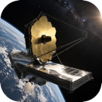
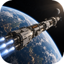
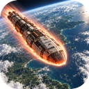
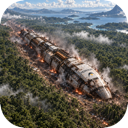
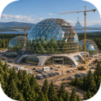
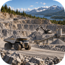
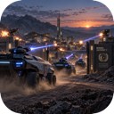
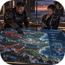

# Zubrenn: First Claim

The first rain on Zubrenn fell while the colony ship was still burning.

It hissed against the hull, ran black through the landing trenches, and gathered in the enormous footprints of the ship’s support struts. Beyond the scorched clearing, silver-leaved trees bent beneath the downpour. Something called from deep inside the forest—a long, rising note answered by another farther away.

You stood beneath the shelter of an open cargo ramp and watched water fall from an alien sky.

Behind you, a thousand colonists waited for orders.

Above you, hidden by the clouds, were the stars you would not be returning to.

---

## A World Within Reach

By the year 2500, Earth had finally learned to act as one world.

It had taken centuries of rivalry, scarcity, and disasters no nation could solve alone. The unity that emerged was imperfect, held together as much by necessity as conviction. But for the first time, humanity could undertake something greater than any single country could afford, endure, or claim.

The United Earth Expedition was its boldest undertaking.

Its observatories searched nearby systems for worlds where humanity might live without spending every waking hour fighting the environment. Most discoveries offered only variations of hardship: frozen oceans beneath kilometers of ice, deserts under poisonous skies, barren rock scorched by unstable stars.

Then the most advanced telescopes ever devised turned toward the most promising candidate found to date orbiting Alpha Centauri.

There were oceans.  There were clouds.  There were forests sprawling across broad continents, their colors shifting with the seasons.  The atmosphere contained breathable levels of oxygen. Liquid water flowed freely across the surface. Gravity fell within tolerable limits. The planet’s biosphere was complex, vigorous, and unlike anything in Earth’s records.

The expedition named the world **Zubrenn**.

For a civilization that had spent generations repairing the damage done to its first home, the discovery felt like forgiveness.

Then came the transmissions.

Some were intercepted near the system. Others arrived as tightly focused signals, repeated in mathematical sequences until their meaning became clear. Humanity was not alone in its interest. Other civilizations had charted Zubrenn. Some claimed prior discovery. Some announced expeditions already underway.

On Earth, celebration gave way to argument, and argument to urgency. A habitable world so close to humanity’s birthplace could become a partner, a refuge, or the stronghold of a power with little concern for Earth’s future.

Waiting was no longer considered safe.

The colony ship *Horizon* departed carrying settlers, scientists, engineers, seed banks, livestock, industrial machinery, components for a biodome and a library containing much of humanity’s accumulated knowledge.

Its instructions were simple enough to fit on a single page:

**Establish a permanent settlement. Secure the means to sustain it. Preserve humanity’s freedom to grow.**

You were given command.

## The Descent

The plan called for thirty days in orbit.

During that time, survey satellites would map the continents, trace weather systems, inspect coastlines, and search for concentrations of useful minerals. Automated landers would test soils and water. Only after comparing dozens of locations would you choose the site of humanity’s first colony.

You had completed less than a day of that work when the alarm sounded.

A maneuvering thruster had failed during an orbital adjustment. Instead of shutting down, it continued firing, pushing *Horizon* out of alignment. Automatic corrections brought other thrusters online. For a few seconds, the ship fought itself.

Then a propellant line ruptured.

On the command deck, the planet began to turn across the forward display.

Emergency valves finally stopped the leak, but the damage was done. The ship had lost a substantial part of its maneuvering reserve, and its new trajectory dipped into the atmosphere. The dedicated descent engines remained intact. There was enough fuel for a controlled landing.

There was no longer enough margin to regain a safe orbit and continue the survey.

The navigation officer brought up three possible landing zones. One lay beneath a vast storm. Another had only low-resolution terrain coverage and might have been marshland.  The third was a broad river valley near a sheltered coast.

You knew almost nothing about the terrain on Zubrenn.

There was no choice, you ordered the bridge crew to pilot the *Horizon* to controlled emergency landing.  The exact site would have to be chosen during descent.

Atmospheric entry turned the windows white. Equipment tore loose in an unmanned storage bay. Somewhere below the command deck, a thousand people heard the change in engine pitch and understood that the landing was happening weeks too soon.

The final descent carried *Horizon* over dark forest, glittering water, and ridges veined with pale stone.

The atmosphere on Zubrenn was denser than expected. The emergency fins did not bleed heat as modeled. The ship struck harder than it was designed to.

Support struts buried themselves in wet earth. A cargo cradle collapsed. The smell of smoke from electrical fires filled the air.  For several seconds, every light aboard went out before coming back on under emergency power.

The *Horizon* had landed with no serious casualties.  All 1000 colonists were now committed to this new world.

## What We Had Brought

The rain helped extinguish the fires.

By morning, survey teams had established a perimeter around the ship. Medical officers kept the settlers behind contamination barriers while they tested local air, water, and biological samples. Drones moved above the trees, extending the map a few kilometers at a time.

The valley offered fresh water, defensible rises, and enough level ground for a settlement. Beyond that, much remained uncertain.

You did not know what lay across the mountain range to the west. You did not know whether the river flooded seasonally or whether the quiet coastline faced storms strong enough to sweep buildings from their foundations.

Most of the planet was still a blur of incomplete images and unanswered questions.

The first council meeting took place in a cargo compartment beneath a flickering work light.

In the seed vaults there were genome sequences for staple crops edited for Zubrenn’s UV spectrum and 620-day growing season. In the fabrication templates there were designs advanced reactors, autonomous factories, and medical systems that could rebuild damaged organs. In the library there were centuries of metallurgy, chemistry, and medicine.  Humanity had not forgotten how to make those things.

But knowledge is not infrastructure. The biodome carried by *Horizon* was the product of an entire planet’s industry. Zubrenn possesed no such advanced infrastructure.  It would have to be built.

The *Horizon* carried 3D printing units could produce a remarkable range of equipment from prepared feedstock. They could not turn an arbitrary heap of alien rock into whatever the colony needed.

Precision manufactured goods required specialized alloys. Those alloys required refined metals, controlled furnaces, chemical reagents, and reliable power. The machines that shaped them needed cutting tools, sensors, lubricants, and replacement parts of their own.

The *Horizon* carried all the components to build the first pre-fabricated biodome: a self-contained habitat with micro-fusion power generation, housing, food production, manufacturing and well drilling equipment. The colony had the technical skills and know how to build almost everything that was needed.  But first they would have to build out the industrial base needed to build more biodomes necessary for establishing new colonies.

That became the work of the first colony on Zubrenn.

Water purification systems appeared beside the river. Imported crops took root in sealed growing houses while researchers tested whether local soils could safely support them.  Locations for extracting materials from the ground were explored.  

Soon construction began outside the biodome: Solar panels for energy production, farms to grow crops and raise livestock, mines to extract precious materials, even a factory to transform raw materials into finished goods and docks to open access to the wealth of the sea.

## The Wealth Beneath Our Feet

The first iron deposit was discovered upstream, exposed where the river had cut into a hillside.  It was not particularly rich. On Earth, it might never have justified a mine.

Nearby quarries supplied stone for foundations and roads. Clay beds yielded the settlement’s first locally made bricks. Carefully managed forest plots provided structural material after testing showed which native woods could be dried and worked safely.

Each discovery changed what was possible.

A small foundry reduced the need to consume the ship’s finite stock of metal. Better tools accelerated construction. Improved roads let haulers carry heavier loads. More dependable power kept workshops running after sunset.

But progress exposed new shortages.

Electronic production depended on elements found only in traces near the landing site. Fertilizer supplies dwindled while agricultural teams searched for accessible phosphate deposits.  Aluminum and titanium were needed for advanced manufacturing. Reliable energy production required finding a source of uranium to fuel a reactor.

Maps acquired new importance. A remote desert basin might hold lithium-bearing brines needed to produce batteries for energy storage. A mountain belt might contain iron or titanium. Somewhere a source of crystalline materials must be found so that desperately needed electronics could be fabricated.

The sea offered its own possibilities.

Offshore fisheries promised a bountiful source of needed protein. Marine organisms supplied compounds of interest to medicine and manufacturing, though every potential use demanded careful study.

The sea was not empty space between valuable lands. It was a resource frontier, a transport network, and eventually another border to defend.

After many years, a second colony was founded beside a rare mineral deposit.  Years after that a third colony was founded near a natural harbor on the coast.

Between them stretched roads, power lines, and supply routes that now mattered as much as the settlements themselves.

## Other Claims

The first alien vessel you saw crossed the northern sky at dusk.

It descended without answering your hail.

Three days later, a survey drone found a cluster of angular structures beyond the eastern hills. Heat shimmered above unfamiliar machinery. Vehicles moved between a landing platform and an excavation site.

Their builders were already mining.

Soon, more signals filled the receivers. Some civilizations had arrived in colony ships like your own. Others sent coordinated fleets or small advance parties supported by distant powers. Their bodies, languages, and requirements differed. So did their ideas about ownership.

One delegation recognized a claim only where a settlement physically stood.

Another insisted that using a river gave it authority over the entire watershed.

A third offered to recognize your borders in exchange for exclusive access to everything beneath them.

Not every encounter began with a threat.

Your first successful trade agreement was negotiated through translation software that rendered both sides’ statements with painful literalness. The visitors possessed a heat-resistant ceramic your workshops could not yet manufacture reliably. They wanted iron, purified industrial water, and access to your coastal weather data.

The exchange kept a critical power system operating.

Later agreements brought rare materials, specialist components, and knowledge of regions your scouts had never reached. Trade routes became lifelines. A reliable neighbor could provide in one shipment what might otherwise take years to produce at home.

But reliance carried risks.

Prices rose when suppliers learned how badly you needed their goods. Convoys vanished. Border disputes closed routes without warning. A civilization willing to trade one season might use that dependence to demand territory the next.

And some preferred conquest from the beginning.

## The Price of a Foothold

The attack came at a mining outpost before dawn.

Its final transmission showed unfamiliar machines moving through the perimeter lights. Then the feed failed.

By midday, the attackers had broadcast their terms. The mine and surrounding valley were now under their protection. Human personnel would be permitted to leave. Equipment would remain.

The deposit supplied materials needed by half your advanced workshops.

At the emergency meeting, there was no agreement about what to do.

One adviser urged negotiation. Another proposed buying replacement supplies from a different civilization. Your engineers warned that converting the workshops to substitute materials would take months.

Your security commander called up a map on the table.

You could recapture the mine by force, but not without losses.

You looked at the road leading to the outpost. You had approved its construction. You knew how many weeks it had taken to cut through the hills.

Until then, expansion had been measured in houses built, fields planted, and tonnes delivered.

Now it would also be measured in lives.

You ordered the nearby colonies reinforced, opened negotiations, and sent reconnaissance teams to discover exactly what forces held the mine. Whatever came next, it would not be decided by anger alone.

Beyond the council chamber, the settlement continued working. Welders repaired a transport. Children walked to lessons through corridors that had once housed cargo. In the growing domes, the next harvest was beginning to flower.

There was something here worth protecting.

## First Claim

Years after the landing, you climbed the ridge above *Horizon*.

The ship still dominated the valley, but the colony had grown beyond it. Freight transports followed the river toward the inland settlements. Harbor lights marked the coast. On the western horizon, the furnaces of the industrial district glowed beneath the evening clouds.

Much of Zubrenn remained unexplored.

Somewhere beyond your maps were richer deposits, fertile valleys, sheltered ports, and places no human had yet imagined. There were also rival colonies expanding toward the same rivers and mountain passes.

Your people had brought the knowledge of a great civilization across the stars. Here, they had learned how much labor stood between knowing a thing and making it.

Now each new capability widened their choices.

You could secure a vital resource through trade, cultivate an alliance, or build the forces to seize it. You could establish a distant colony and accept the burden of defending it. You could make your neighbors dependent on your industry — or discover, too late, that you had become dependent on theirs.

Below you, a survey convoy assembled at the edge of the city.

Its destination was a blank region west of the mountains.

You watched its lights begin to move.

**Humanity had survived its arrival on Zubrenn. Its future was still unclaimed.**
